<!--
title: Android app guide
section: Guides
order: 1
desc: Every screen in the Droidspaces Android app: the Home, Containers and Panel tabs, the container menu, the rootfs repository, the terminal, service management and Settings.
keywords: droidspaces, android, app, guide, containers, panel, terminal, systemd, services, repository, settings, daemon, mode
-->

# Android app guide

The app has three tabs along the bottom, **Home**, **Containers** and **Panel**, and a gear icon in the top right for **Settings**. This page goes through them in that order. If you have not installed a container yet, start with the [installation guide](Installation-Android.md).

## Home

<p align="center">
  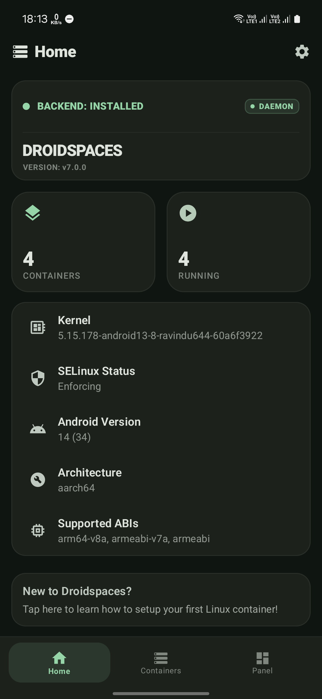
</p>

A status card says whether the backend is installed and up to date, which version it is, and whether the daemon is running. Below it are the number of installed and running containers and the device's kernel version, SELinux state, Android version and architecture. The card at the bottom opens the installation guide.

"Backend: Update available" appears after an app update. Tap it to install the new backend; running containers are not affected.

## Containers

<p align="center">
  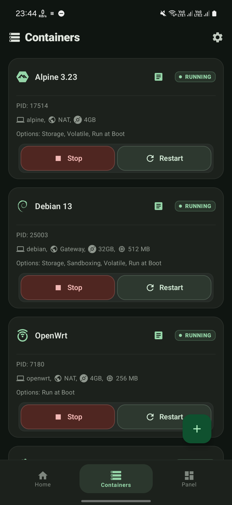
  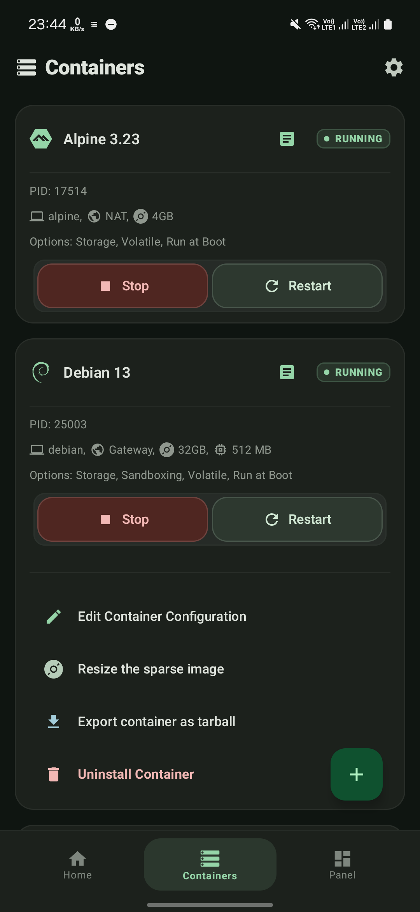
  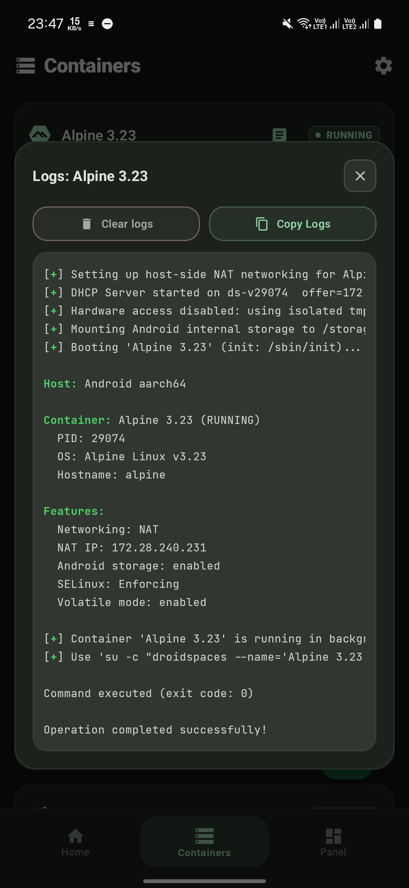
</p>

Every installed container has a card with its name, state, hostname, network mode, image size and resource limits, plus the options that are turned on. **Start** boots the container. A log window opens and shows the backend's output live, and you can close it once the operation finishes; **Stop** and **Restart** do the same. Once the container is running the card shows its PID and the buttons change to **Stop** and **Restart**.

Press and hold a card for its menu:

- **Edit Container Configuration**: the same form as at install time. Every setting on it is explained in [container settings](Features.md). Changes apply at the next start.
- **Migrate to a sparse image**: converts a directory container to an ext4 image file.
- **Resize the sparse image**: changes the ceiling of an image container.
- **Export container as tarball**: packs the rootfs and its settings into a `.tar.gz` you can install on another phone. Environment variables are left out unless you choose to include them, since they often hold secrets.
- **Uninstall Container**: stops the container if it is running and deletes its rootfs and settings. You type the name to confirm. See [uninstallation](Uninstallation.md) for what stays behind.

The **+** button adds a container, from the **Repository** or **Install from file**.

### Repository

<p align="center">
  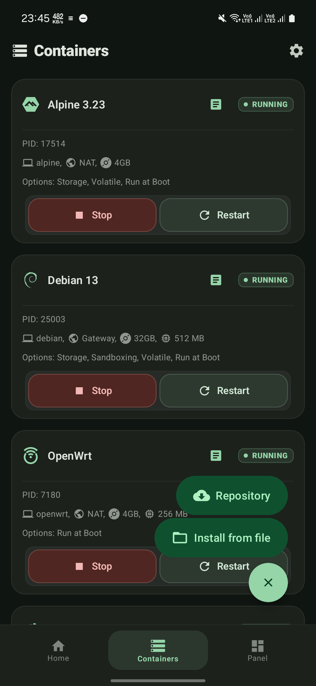
  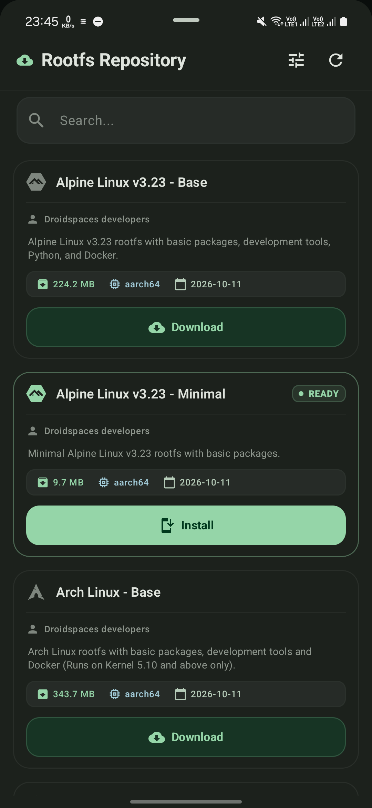
</p>

A list of distributions built for Droidspaces, filtered to your device's architecture. Search by name. **Download** fetches the tarball into your Downloads folder and shows progress on the card; a notification tells you when it is done, and the button turns into **Install**. A download that fails gets a **Retry** button, and a tarball downloaded earlier is recognised the next time you open the sheet.

**Manage Repositories** in the sheet's header lets you subscribe to other feeds that publish a `rootfs.json`. The Linux Containers mirror is the one worth adding, for distributions and versions the official repository does not build:

```
https://raw.githubusercontent.com/Droidspaces/linuxcontainers-mirror/refs/heads/main/rootfs.json
```

### Install from file

Picks a `.tar.xz` or `.tar.gz` rootfs archive from the phone's storage. A container exported from Droidspaces carries its settings and they are filled into the wizard, with a warning page first so you can review them. Any other rootfs tarball works too, as long as it has an init system.

### The setup wizard

<p align="center">
  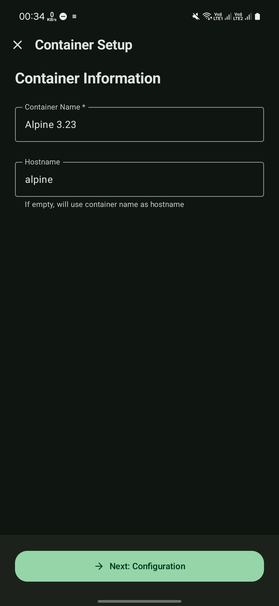
  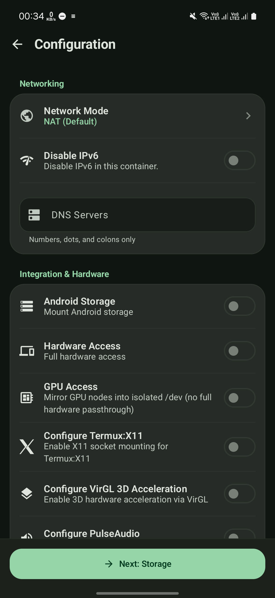
  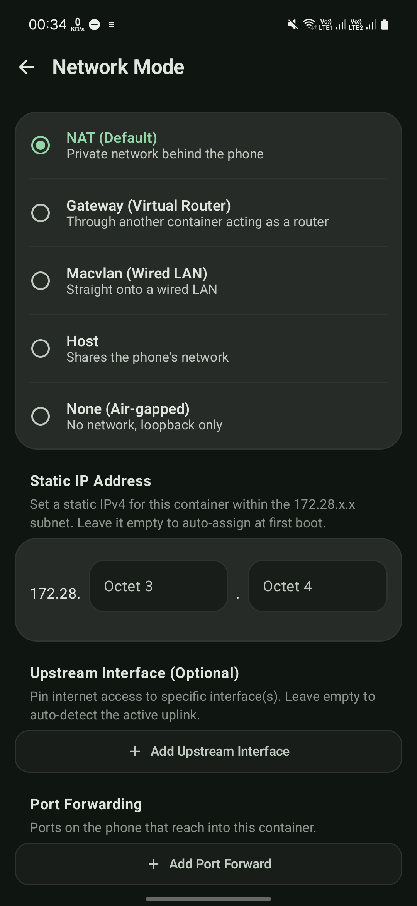
</p>
<p align="center">
  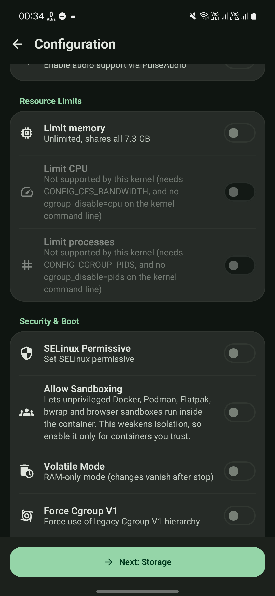
  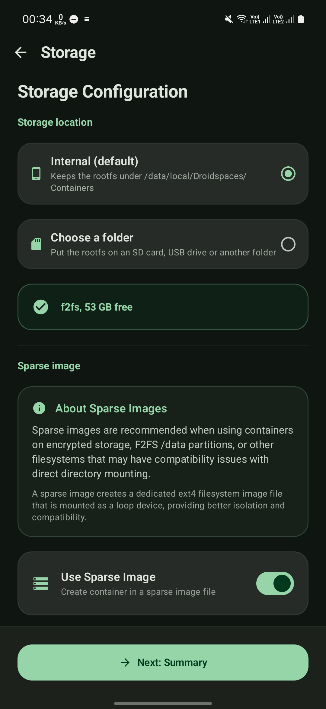
  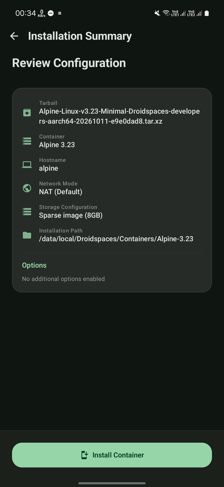
</p>

Name and hostname, then the configuration form, then storage, then a summary. The [installation guide](Installation-Android.md#the-setup-wizard) walks through it, and [container settings](Features.md) explains every toggle.

## Panel

<p align="center">
  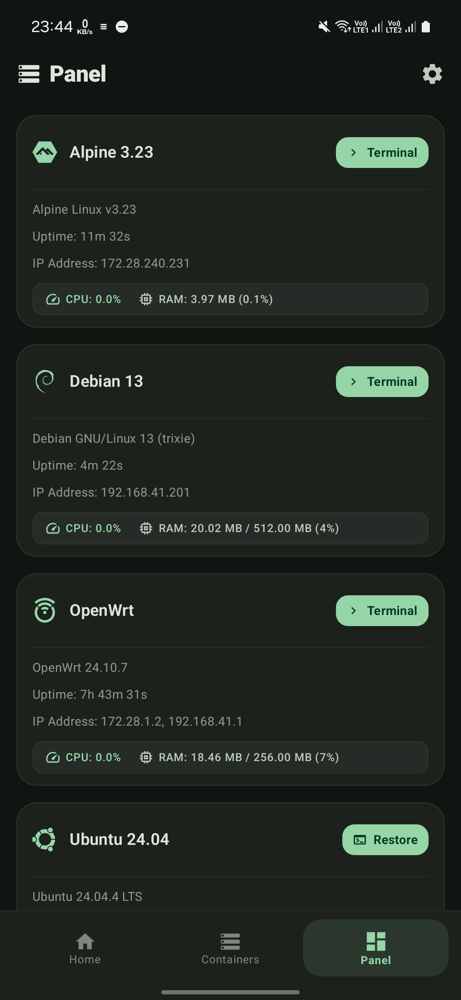
  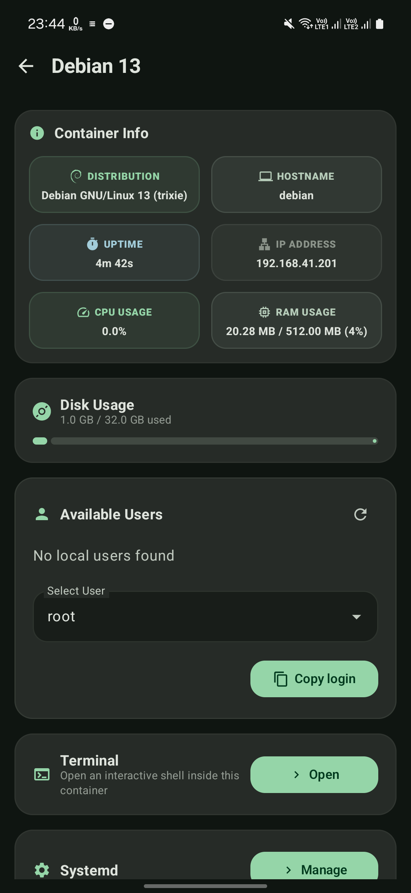
</p>

Only running containers appear here, each with its uptime, IP address, CPU and RAM. With a memory or CPU limit set, usage is shown against the limit. **Terminal** opens a shell straight from the card, and a container with [Anland Display](Anland.md) on gets a **Launch Anland** button next to it once its desktop is up. Tapping anywhere else on the card opens the container's details.

### Container details

- **Container Info**: distribution, hostname, uptime, IP address, CPU and RAM.
- **Terminal**: tap **Open** for a shell. When sessions are already running, the card says so and tapping it brings them back.
- **Available Users**: the user accounts in the rootfs. Pick one and tap **Copy login** to get a `droidspaces enter` command for that user on the clipboard, for use in Termux or any other root shell.
- **Disk Usage**: space used and total.
- **Init System**: tap **Manage** to control services. What you get depends on the init system.

### Managing services

<p align="center">
  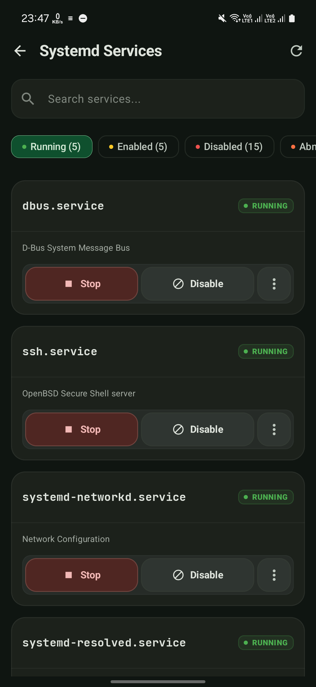
</p>

**Systemd.** The list shows every unit with its state and is filterable: all, enabled, disabled, masked, static, or units in an abnormal state. Each one can be started, stopped, restarted, enabled, disabled or masked, and **View logs** shows its journal. **Inspect unit** opens the unit's properties, dependencies and `systemctl status` output, and **Edit override** writes a drop-in for it, so you can change a service's settings from the phone without a text editor in the container.

**OpenRC**, **OpenWrt (procd)** and **runit** get the same list with start, stop, restart, enable and disable, reload on OpenWrt, and a run-at-boot toggle on runit, which adds or removes the service's `down` file.

## Terminal

<p align="center">
  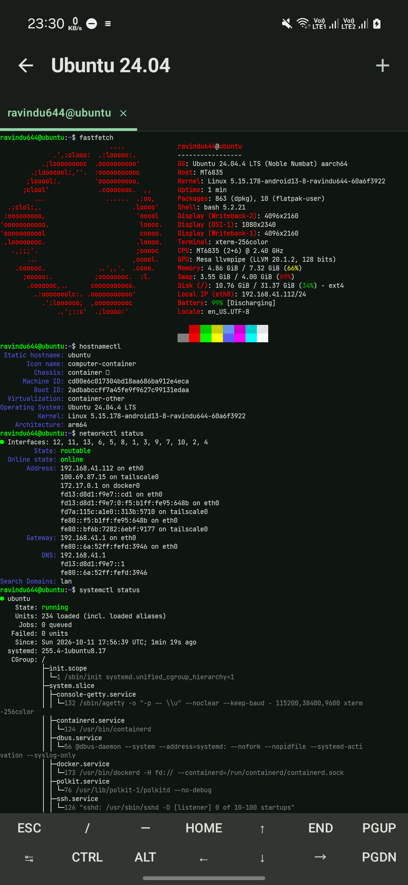
  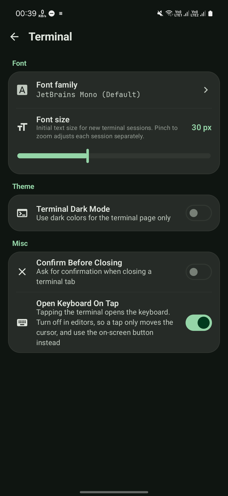
</p>

The built-in terminal opens a shell in the container as the user you pick. Tabs are labelled `user@hostname`; the **+** tab opens another session, and asks for the user each time. Sessions run in a foreground service, so they survive leaving the screen, switching apps and the screen turning off, and the notification has an exit button and a wake lock toggle.

Pinch to zoom changes the text size. Tapping the terminal opens the keyboard. The **Terminal** page under **Settings** has the font, with a custom monospace font import, the starting text size, a dark mode for the terminal page only, a confirmation before a tab closes, and **Open Keyboard On Tap**. Turn that one off when you work in an editor, so a tap only moves the cursor; a keyboard button then appears in the terminal to open and close the keyboard.

## Settings

<p align="center">
  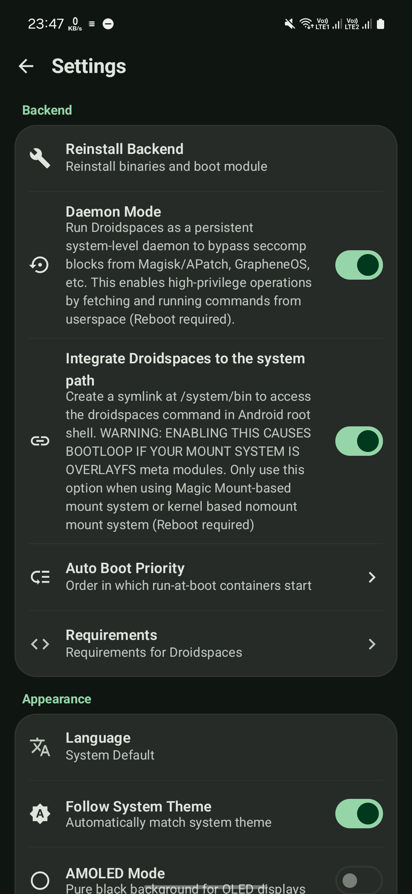
  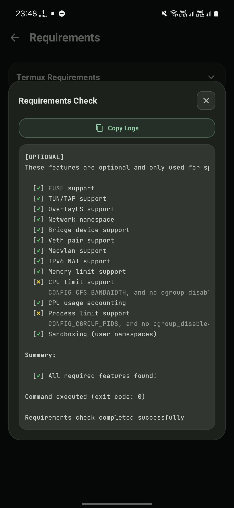
</p>

**Backend**

- **Reinstall Backend**: writes the binaries and the boot module again. Use it if the Home tab reports the backend as corrupted.
- **Daemon Mode**: on by default. The backend runs as a system daemon started at boot, outside the root shell, which gets past the seccomp filter Magisk and APatch put on root shells. Leave it on; changing it needs a reboot.
- **Integrate Droidspaces to the system path**: puts `droidspaces` on the `PATH` of every root shell through the boot module, so you can type `droidspaces` instead of `/data/local/Droidspaces/bin/droidspaces`. Read the warning on the toggle: on OverlayFS-based module systems it causes a boot loop.
- **Auto Boot Priority**: the order in which containers with Run at Boot start. Drag to reorder. A gateway container goes above the containers that route through it.
- **Requirements**: lists the kernel options Droidspaces needs, with a copy button for kernel builders, and **Check Requirements** runs every probe against the running kernel.

**Appearance**: language, light and dark theme, AMOLED black, the system colour palette on Android 12 and newer, accent colour, and the terminal settings above.

**Updates**: check for a new app release.

**Debugging**: **Generate a bug report** collects logs and device information into one file to attach to an issue.

**Experimental**: **Use the 64-bit backend** appears only when the ROM is 32-bit on a 64-bit kernel, and switches the backend to the 64-bit build.

**About**: version, developers, links to the source, the Telegram channel and the contributors.

## Where the data is

Everything the backend creates is under `/data/local/Droidspaces`: the binaries in `bin/`, each container's rootfs or image and its `container.config` in `Containers/<name>/`, and logs in `Logs/`. The app only reads and writes there; uninstalling the app does not touch it, and the daemon keeps running.

---

Previous: [Linux installation](Installation-Linux.md) | Next: [Container settings](Features.md)
