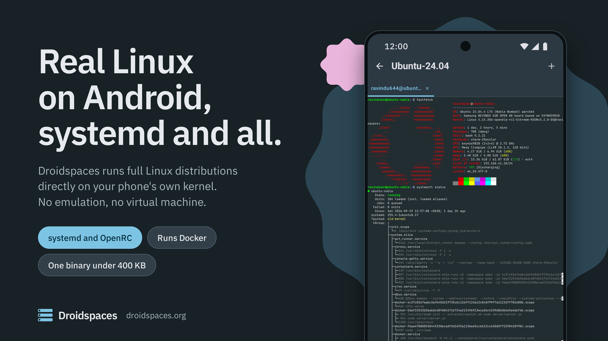

English | [简体中文](./Documentation/zh-CN/README.md)

# Droidspaces

Droidspaces runs full Linux distributions as containers on a rooted Android phone or a Linux PC. Each container boots its own init system, whether systemd, OpenRC or any other, on the host's kernel.

**There is no emulation and no virtual machine**, so programs run at native speed. One static binary under 400 KB does all of it, and the Android app drives that binary so you never need a terminal to get started.

## What you get

- **A real Linux system, not a chroot, not a virtual machine.** Ubuntu, Debian, Fedora, Arch, Alpine, NixOS, OpenWrt and more boot with their own init as PID 1. Services, timers, `reboot` from inside the container, all of it works.
- **Networking that works out of the box.** NAT mode gives every container its own address and internet, with no setup. Gateway mode hands a container's LAN to an OpenWrt container that does DHCP, DNS and firewalling. Macvlan puts a container straight on a wired LAN with its own address from your router.
- **A desktop on your phone.** Anland or Termux:X11 for the display, VirGL or Qualcomm's Turnip for the GPU, and PulseAudio for sound, all started for you. Turn on the toggles, start the container, and the desktop environment appears with sound.
- **Hardware when you want it.** GPU, USB, sensors and block devices can be exposed to a container with one toggle. Docker and Podman run inside containers on every supported kernel.
- **Containers that stay up.** On Android a container can start at boot, before you unlock the phone, and keeps running **for months**, whether the app is open, closed or uninstalled. Everything lives in `/data/local/Droidspaces`.
- **The same binary on Linux.** Every feature of the CLI works the same on a Linux PC. Packages are built for aarch64, armhf, x86_64, x86 and riscv64.

## Requirements

**Android**

- A rooted device. **KernelSU is recommended**. Magisk and APatch work too.
- A kernel built with the options Droidspaces needs. Most stock kernels lack them. See the [kernel configuration guide](Documentation/Kernel-Configuration.md), or pick a phone from the [community-supported devices](Documentation/community-supported-devices.md) list, which links to ready-made kernels.
- Kernel 3.10 or newer. 4.9 and newer is where most distributions work well.

**Linux**

- Kernel 3.10 or newer and root. Any current desktop distribution has everything else. Run `sudo ./droidspaces check` to confirm.

## Get started

**Android**

1. Install the APK from the [latest release](https://github.com/ravindu644/Droidspaces-OSS/releases/latest), grant root, open it, and let it install the backend. Reboot when it asks.
2. Open the **Containers** tab, tap **+**, then **Repository**. Pick a distribution, tap **Download**, then **Install**, and walk through the setup.
3. Tap **Start**. Open the **Panel** tab and tap **Terminal** to get a shell.

The [Android installation guide](Documentation/Installation-Android.md) covers each step in detail.

**Linux**

The [Linux installation guide](Documentation/Installation-Linux.md) shows how to install Droidspaces, where to get a rootfs and how to put it in an image file.

## Screenshots

<table>
  <tr>
    <td width="33%" align="center"> Home</td>
    <td width="33%" align="center"> Containers</td>
    <td width="33%" align="center"> Panel</td>
  </tr>
</table>

## Security

> [!WARNING]
>
> Droidspaces is a privileged container runtime.
>
> Root inside a container is powerful, and a hostile root process can reach the host.
>
> Do not run code you do not trust in a container, and use a normal user with `sudo` for daily work, as you would on any Linux machine.
>
> Hardware access and privileged mode relax the remaining barriers further, so turn them on only when you need them.

## Documentation

Everything below is also on the [documentation site](https://www.droidspaces.org/docs/), rendered and searchable.

| Page | What it covers |
|------|----------------|
| [Android installation](Documentation/Installation-Android.md) | From a rooted phone to a running container, in the app. |
| [Linux installation](Documentation/Installation-Linux.md) | Installing the binary and preparing a rootfs on a PC. |
| [Android app guide](Documentation/Usage-Android-App.md) | Every screen in the app and what it does. |
| [Container settings](Documentation/Features.md) | Each toggle and flag: what it does and when to use it. |
| [Linux CLI](Documentation/Linux-CLI.md) | Every command, flag and config file key. |
| [Networking from zero](Documentation/Networking-From-Zero.md) | How the network modes work, from IP addresses up to an OpenWrt gateway. |
| [Display, audio and desktop](Documentation/Graphics-and-Audio.md) | GPU acceleration, sound and a desktop environment on Android and Linux. |
| [Anland](Documentation/Anland.md) | A Wayland desktop on Android through the Anland app, for KDE Plasma and other Wayland compositors. |
| [Kernel configuration](Documentation/Kernel-Configuration.md) | Building an Android kernel with Droidspaces support. |
| [Recipes](Documentation/Cool-things-you-can-do.md) | A phone as a home server with Tailscale, Docker inside a container, and more. |
| [Troubleshooting](Documentation/Troubleshooting.md) | Symptoms, causes and fixes. |
| [Community-supported devices](Documentation/community-supported-devices.md) | Phones known to run Droidspaces, with kernel sources. |
| [NixOS](Documentation/Nix-NixOS.md) | Building and configuring a NixOS container. |
| [Uninstallation](Documentation/Uninstallation.md) | Removing Droidspaces from Android or Linux. |

## Community and contributing

Questions and help: the [Telegram channel](https://t.me/Droidspaces). Bugs and feature requests: [GitHub issues](https://github.com/ravindu644/Droidspaces-OSS/issues).

Code contributions start with [CONTRIBUTING.md](CONTRIBUTING.md). App translations are on Weblate:

## Credits

- [LXC](https://github.com/lxc/lxc), the architectural inspiration.
- [BusyBox](https://busybox.net/), the static binary the app uses for extraction and setup ([our build](https://github.com/Droidspaces/busybox-droidspaces)).
- [ReTerminal](https://github.com/RohitKushvaha01/ReTerminal), [Termux](https://github.com/termux/termux-app) and [LXC-Manager](https://github.com/Container-On-Android/LXC-Manager), the terminal emulator backend.
- [JetBrains Mono](https://www.jetbrains.com/legalforms/fonts/), the monospace typeface in the app, under the [SIL Open Font License 1.1](https://scripts.sil.org/OFL).

## License

[GNU General Public License v3.0](./LICENSE). Copyright (C) 2026 [ravindu644](https://github.com/ravindu644) and contributors.
